<p><h1 align="center">S001.基于springboot+vue的校园招聘系统</h1></p>

###  获取完整源码和sql数据库文件（完全免费）:  微信: littlepinia88 qq：1104515926
###  所有项目以及源代码本人均调试运行无问题 可支持远程安装部署调试、定制修改、代码讲解

## 简介

> 本代码来源于网络,仅供学习参考使用!
>
> 提供1.远程部署/2.修改代码/3.设计文档指导/4.框架代码讲解等服务
>
> 访问地址：http://localhost:8080/
> 
> 管理员：admin 123
> 
> 学生：张三 123
> 
> 企业：alibaba 123
>

## 项目介绍
本项目是一个基于 Spring Boot + Vue2 的前后端分离校园招聘系统，面向高校毕业生求职与企业招聘场景，打通了学生注册与简历完善、企业发布职位、学生在线投递、企业筛选简历、管理员统筹运营的完整招聘业务闭环。后端以 REST 接口提供数据服务，前端 Vue2 + Element UI 同时承载公开求职门户与学生、企业、管理员三套登录后工作台，可作为 Java 毕业设计或前后端分离实践案例。

### 系统角色
- **管理员**：登录后台，维护企业与学生账号、职业分类、招聘资讯栏目与文章、招聘会，并查看毕业生就业去向。
- **企业用户**：注册登录后维护企业资料，发布与管理招聘职位，查看学生投递的简历并筛选。
- **学生用户**：注册登录后维护个人资料与在线简历（可设置简历开放或关闭），完善求职意向、培训、证书、项目与工作经历，浏览职位并投递、收藏职位。
- **权限控制**：登录接口按 type 区分三类角色，成功后下发 UUID token 并存入 Redis；`TokenInterceptor` 校验请求头 token（放行 `/login`、`/upload/**`、`/f/**` 公开接口），`@RequiresRoles` 注解配合 `RoleAspect` 切面做角色级接口控制。

### 用户端功能
1. **公开门户浏览与注册**：首页轮播与推荐、职位列表与详情（`/f/post`）、企业列表与详情、资讯文章与栏目树（`/f/article`、`/f/channel`），学生与企业可分别在线注册。
2. **简历与求职档案**：维护个人资料与在线简历（含求职状态、技能、自我评价，可设置开放 1 / 关闭 0），并维护求职意向、培训经历、证书、项目经验、工作经历等子模块。
3. **职位投递与收藏**：按职位投递简历，系统校验重复投递与简历是否开放，可查看投递记录与状态，并收藏感兴趣的职位。
4. **企业职位管理**：企业维护自身资料，发布、编辑招聘职位（职位含名称、学历要求、薪资、描述），并查看本企业收到的投递记录、关联查看学生简历进行筛选。

### 管理端功能
1. **账号与字典**：管理员账号管理、数据字典维护。
2. **招聘运营**：职业分类树管理、企业与学生账号管理、招聘资讯栏目与文章管理、招聘会信息（名称、日期、地点、链接、企业）维护。
3. **就业去向**：查看毕业生就业去向登记（单位、岗位、薪资等）。

### 技术栈
- **后端框架**：Spring Boot 2.3.7.RELEASE、Spring MVC、MyBatis（mybatis-spring-boot-starter 2.1.4）、Spring AOP
- **数据访问**：MySQL 8.0.19 驱动，库 `s001_campus_job`；PageHelper 1.3.0 物理分页；Spring Data Redis（Lettuce）缓存登录 token
- **前端**：Vue 2.6.11、Vue Router 3.5.2（history 模式）、Vuex 3.6.2、Element UI 2.15.6、Axios 0.24.0，辅以 Swiper 轮播与 mavon-editor 富文本
- **工程能力**：统一 `Result` 响应模型、全局异常处理、登录拦截器与角色切面、CORS 跨域配置、Lombok

### 核心数据表
- `tb_user` 管理员表：账号 `userName`、密码、姓名
- `tb_company` 企业表：账号 `account`、密码、企业名称
- `tb_student` 学生表：账号 `account`、密码、姓名
- `tb_post` 职位表：职位名 `name`、学历 `education`、薪资 `salary`、描述、所属企业 `companyId`
- `tb_send` 投递记录表：学生 `studentId`、职位 `postId`、企业 `companyId`、简历 `resumeId`、状态 `status`、投递时间 `sendDate`
- `tb_resume` 简历表：求职状态 `jobStatus`、技能 `skill`、评价 `evaluate`、所属学生 `studentId`、是否开放 `status`
- `tb_favor` 收藏表、`tb_intention` 求职意向表、`tb_article`/`tb_channel` 资讯文章与栏目表、`tb_joblist` 招聘会表（`jobDate`、`jobPlace`、`jobUrl`、`jobCompany`）

### 工程结构
```
S001CampusRecruitmentSystem
├── job-admin/                 后端 Spring Boot 工程
│   └── src/main
│       ├── java/top/ludonghuang
│       │   ├── controller/    管理端 REST 控制器
│       │   ├── front/         门户公开接口（/f/**）
│       │   ├── service/       业务接口与实现
│       │   ├── mapper/       MyBatis Mapper 接口
│       │   ├── entity/        实体类
│       │   └── framework/    Redis 工具、TokenInterceptor、角色注解与切面、全局异常
│       └── resources
│           ├── application.yml 端口 8888、context-path /job、数据源与 Redis
│           └── mappers/      MyBatis Mapper XML
├── job-vue-web/               前端 Vue2 工程
│   └── src
│       ├── front/             公开门户页面（首页/列表/详情/注册）
│       ├── views/             学生、企业、管理员登录后工作台
│       ├── router/            index + student/company/user 三套路由
│       ├── api/               Axios 接口封装
│       └── store/  utils/
└── screenshot/                运行截图
```

### 补充说明
- 后端实际端口为 8888、上下文路径 `/job`（见 `job-admin/src/main/resources/application.yml`），需先创建数据库 `s001_campus_job` 并导入 SQL 后运行。
- 登录密码以明文比对，未做加密存储；登录态依赖 Redis，需本机启动 Redis。
- 图片上传保存到本地目录 `c:/upload/job/`，通过 `/job/upload/**` 映射访问。

## 环境

- <b>IntelliJ IDEA 2021.3</b>

- <b>Mysql 5.7.26</b>

- <b>Node 14.14.0</b>

- <b>Redis 3.0</b>

- <b>JDK 1.8</b>

## 运行截图
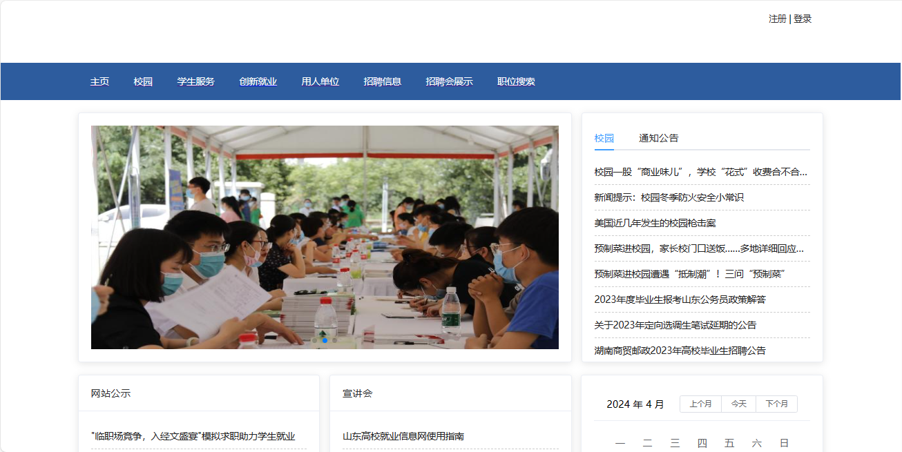

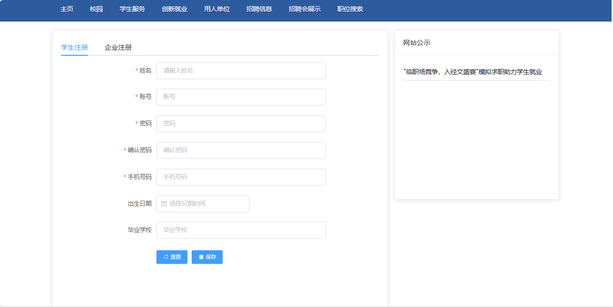

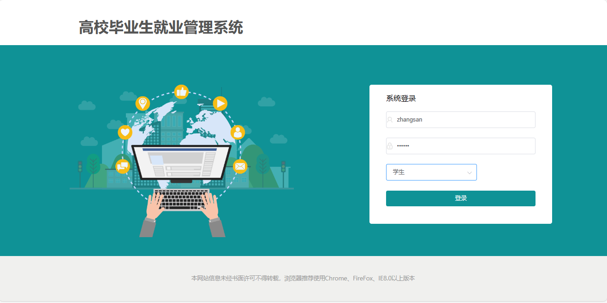

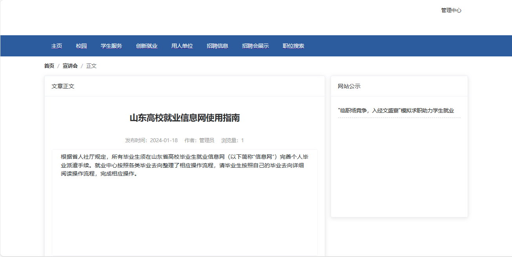

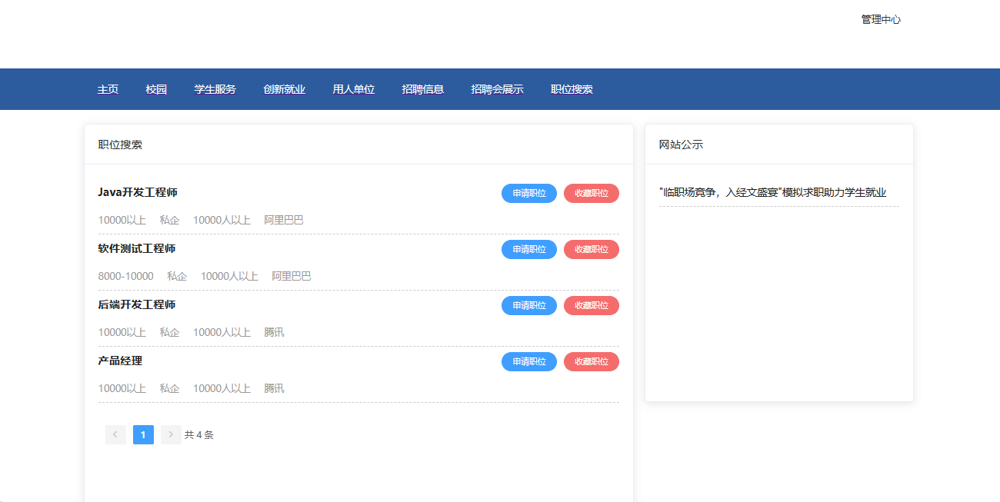

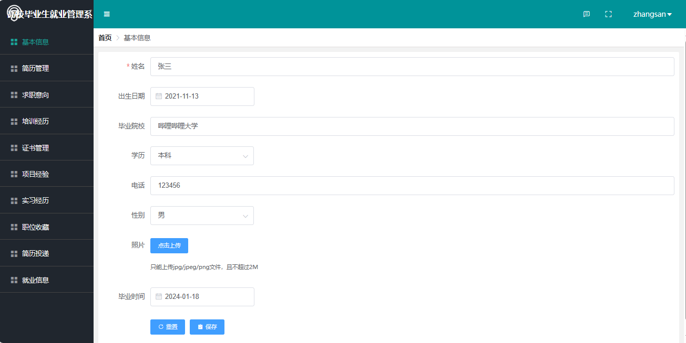

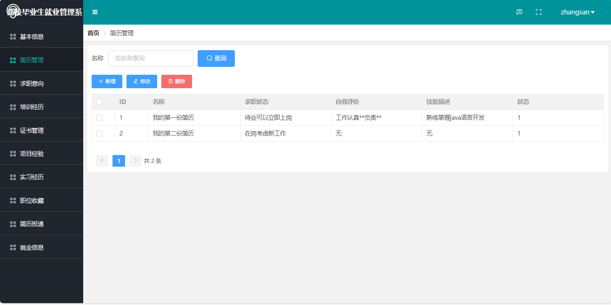

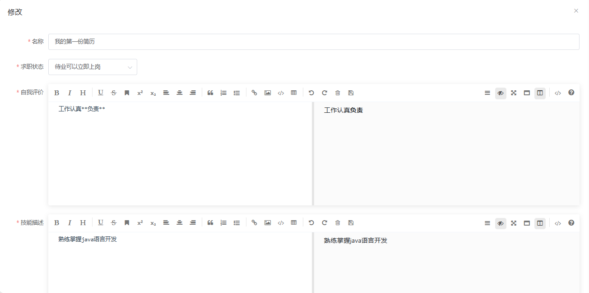

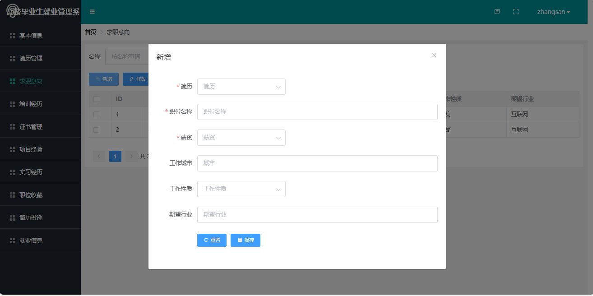

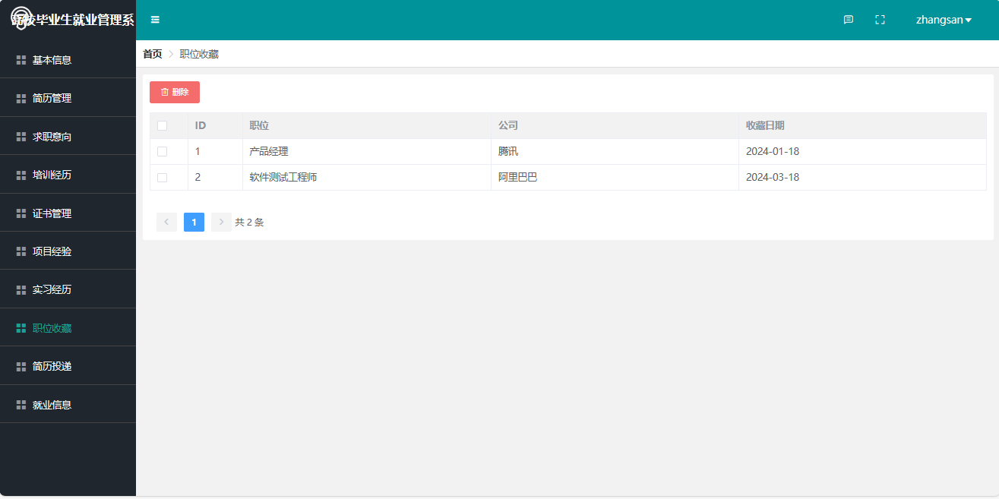

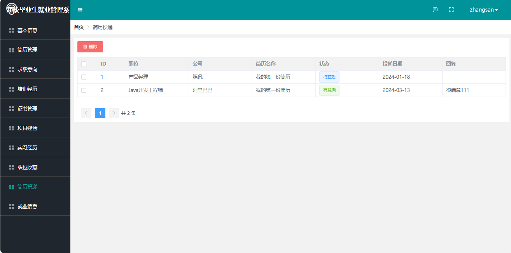

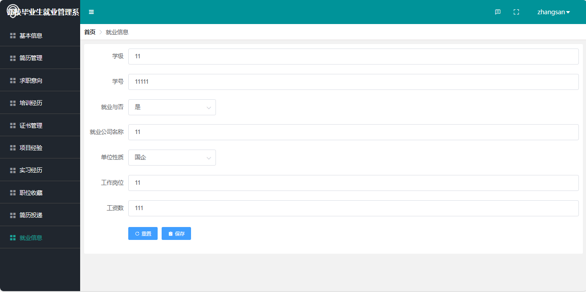

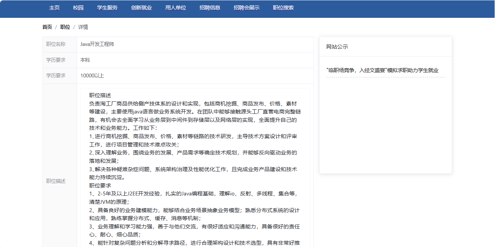

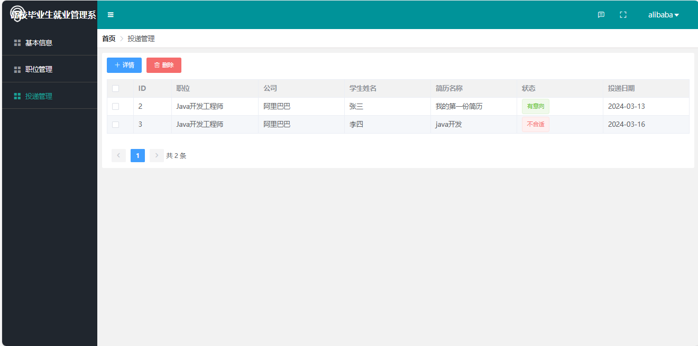

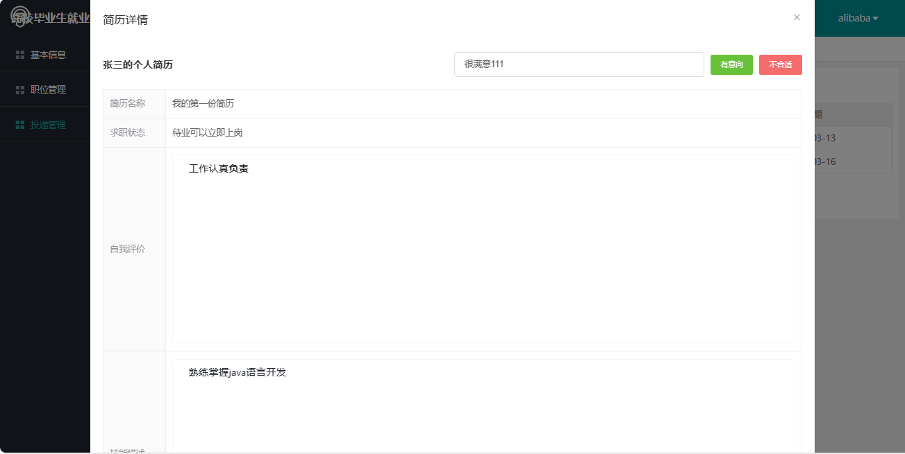

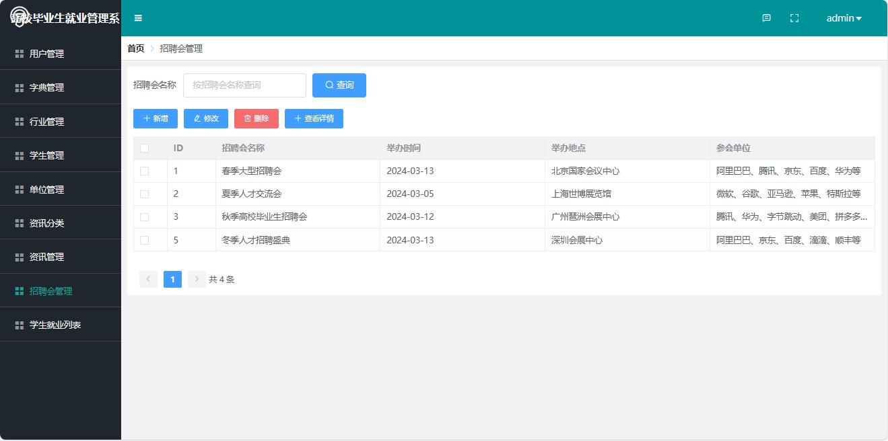

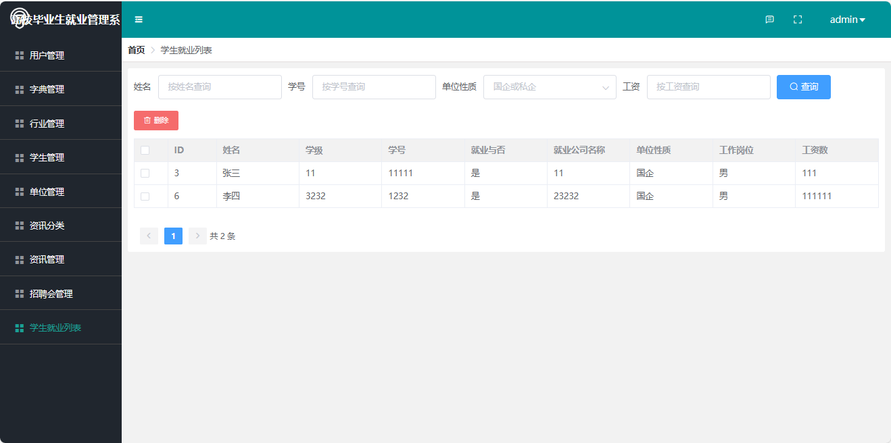